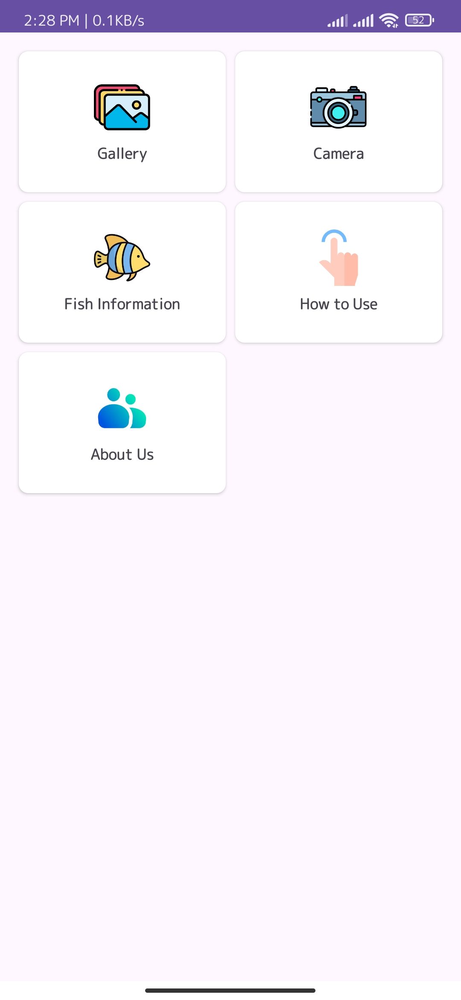
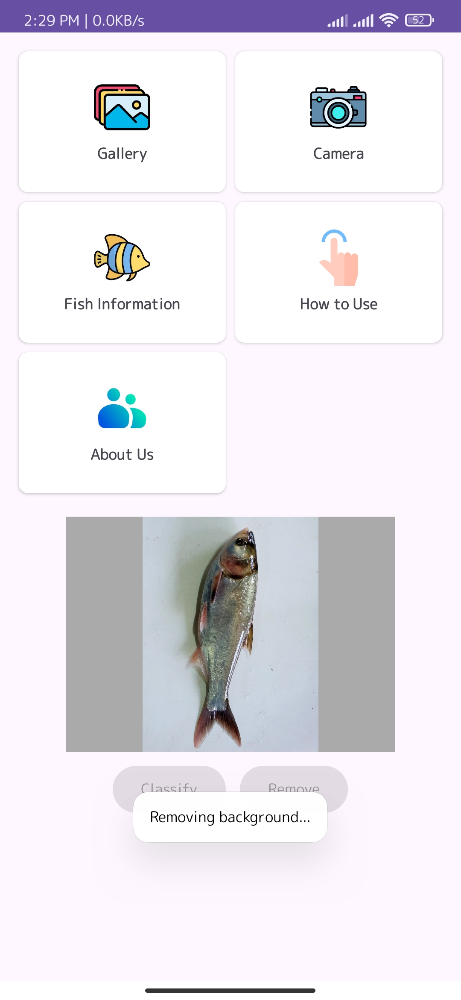
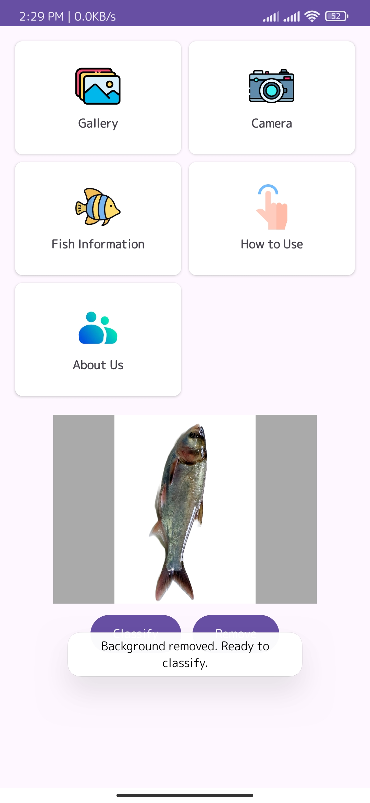
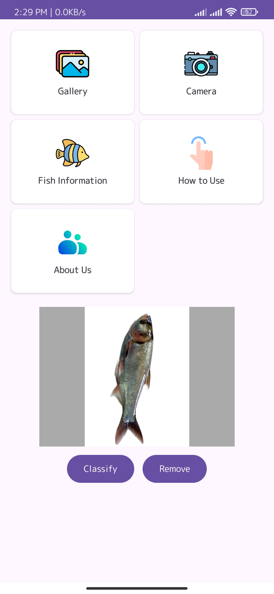
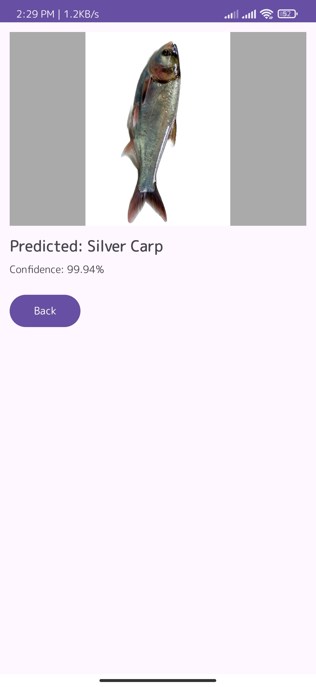

# 🐟 Fish Classification Android Application

An Android application that classifies fish images using a trained TensorFlow Lite model. Users can capture fish images directly using their device camera or select images from the gallery. Before classification, the application removes the image background and replaces it with a white background to focus on the fish.

## ✨ Features

- **Fish Classification:** Classifies fish images using a trained TensorFlow Lite model.
- **Camera Capture:** Capture fish images directly using the device camera.
- **Gallery Selection:** Select existing fish images from the device gallery.
- **Background Removal:** Automatically removes the background and keeps the fish object with a white background.
- **Classification Results:** Displays the predicted fish category after image processing.
- **Easy-to-Use Interface:** Simple and user-friendly application interface.
- **Real-World Testing:** Supports fish image classification using both gallery images and camera captures.

## 📱 Application Workflow

The following screenshots demonstrate how the application works, from opening the app to obtaining the classification result.

### 1. Application Home Screen

The home screen provides the main options for using the application.

<p align="center">
  
</p>

### 2. Selecting an Image

Users can select a fish image from their device gallery. The application then automatically starts the background removal process.

<p align="center">
  
</p>

### 3. Background Removed Image

After image processing, the application displays the fish with the unwanted background removed.

<p align="center">
  
</p>

### 4. Processed Image Before Classification

The processed image has a white background and is ready to be passed to the fish classification model.

<p align="center">
  
</p>

### 5. Fish Classification Result

After background removal, the processed image is passed to the trained TensorFlow Lite model, and the application displays the predicted fish category.

<p align="center">
  
</p>

## 🎥 Real-World Application Demonstration

The following video demonstrates the application in a real-world market environment.

### Fish Classification Using Camera

This video demonstrates capturing fish images directly at a local market using the device camera and classifying them with the application.

<p align="center">
  <a href="https://drive.google.com/file/d/12i4N9xYddJYF7TyNG7IumaDtxD7mCiB2/view?usp=sharing">
    
  </a>
  <br/>
  ▶️ <b>Click the thumbnail to watch the demonstration video.</b>
</p>

## ⚙️ How the Application Works

The application follows these steps to classify a fish image:

1. **Image Input:** The user captures an image using the camera or selects one from the gallery.
2. **Image Segmentation:** The application processes the image to separate the fish from its background.
3. **Background Replacement:** The unwanted background is removed and replaced with white.
4. **Image Classification:** The processed image is passed to the trained TensorFlow Lite classification model.
5. **Result Display:** The application displays the predicted fish category.

### Application Workflow

```text
       Camera / Gallery
              |
              v
         Input Image
              |
              v
      Fish Segmentation
              |
              v
      Background Removal
              |
              v
       White Background
              |
              v
    TensorFlow Lite Model
              |
              v
        Classification
              |
              v
        Display Result
```

## 🛠️ Technologies Used

- **Programming Language:** Java
- **Development Environment:** Android Studio
- **Machine Learning Framework:** TensorFlow Lite
- **Image Processing:** Android Bitmap Processing
- **Deep Learning:** Image Classification and Image Segmentation
- **Platform:** Android

## 🚀 Application Prerequisites

- Android Studio
- Android device or emulator
- Android SDK
- Java development environment

## 🎯 Project Objective

The main objective of this project is to develop an Android-based fish classification application that makes fish identification easier through image processing and deep learning. By combining background removal with TensorFlow Lite image classification, the application aims to improve the focus on fish objects and provide a convenient way to classify fish images in real-world environments.

This application is developed as part of Fish Classification Research.

## ⚠️ Limitations

Although the application provides satisfactory classification results in most cases, its performance can be affected by variations in lighting conditions and background removal quality. Images captured under different lighting conditions may sometimes lead to incorrect classifications. Additionally, if the background removal process does not completely separate the fish from unwanted objects or background elements, the classification accuracy may decrease.

In contrast, better background removal generally leads to more accurate predictions. During our testing, the application correctly classified fish images approximately 9 out of 10 times. However, occasional misclassification indicates that there is still room for improvement.

Future work will focus on improving segmentation accuracy, handling different lighting conditions, and enhancing the classification model to achieve more consistent and reliable results in real-world environments.

## 👨‍💻 Developer

**SAJIB BORMON**

Bachelor of Science in Computer Science and Engineering  
Daffodil International University

---

⭐ If you find this project interesting, please consider giving this repository a star!
